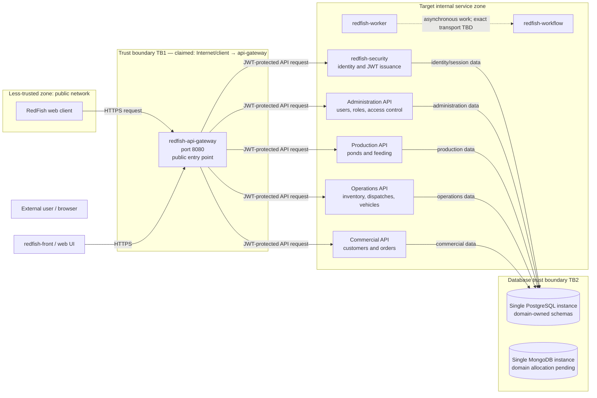

# CP1 — RedFish Attack Surface and Trust Boundaries

## 1. Scope and source-of-truth notes

This map is based on the current [RedFish architecture overview](https://github.com/code-corhuila/redfish-docs/blob/main/05-architecture/overview.md) and the published [API Gateway contract](https://github.com/code-corhuila/redfish-docs/blob/main/07-api/contracts/openapi/api-gateway.yaml).

The architecture overview describes the target distributed topology. It explicitly says that the current source repository is a Java 17 / Spring Boot / Gradle modular monolith and that the migration to the target topology is not yet evidence of completion. Therefore, the diagram distinguishes target components from confirmed deployed components. A broker and external business APIs are not specified in the current architecture overview, so they are not presented as existing components.

## 2. Data-flow diagram

### Boundaries

- **TB1 — claimed:** external client/Internet → API Gateway, public port 8080. This is the boundary analyzed in CP2.
- **TB2 — mapped for context:** internal API → database infrastructure. Database access must use domain-specific application credentials and each domain must write only its own data.
- **Service-to-service boundaries:** the gateway routes requests to APIs. Each service must validate the JWT itself; the gateway only checks that the Authorization header is present and does not validate the token or inject trusted user identity.
- **Unspecified integrations:** no message broker or external business API is asserted as deployed because the reviewed architecture source does not identify one. Update this map if the team confirms such a component in another current document.

## 3. Asset inventory for TB1

| Asset | Where it lives / crosses | Classification | Security concern |
|---|---|---|---|
| Access JWT (including subject, roles and permissions) | Client request header; validated by downstream service | Restricted | Theft, replay, forgery, or accepting expired/invalid tokens |
| Request body and query parameters | Client → gateway → target API | Confidential or restricted depending on endpoint | Tampering, malformed input, injection, unauthorized changes |
| User identity and authorization context | JWT claims consumed by APIs | Restricted | Spoofing or trusting client-supplied identity headers |
| Routing and upstream configuration | API Gateway configuration | Internal | Unauthorized changes could redirect traffic or expose services |
| Correlation ID and request logs | Gateway headers and logs | Internal | Log injection, accidental sensitive-data logging, traceability gaps |
| API response and error details | Gateway → client | Internal; may contain confidential data if misconfigured | Information disclosure through stack traces or excessive errors |
| Service availability and request capacity | Gateway and upstream APIs | Internal | Flooding can exhaust gateway or downstream resources |

Classification is a working security classification for this exercise; confirm it with the project team before treating it as a formal policy.

## 4. Entry points at the claimed boundary

| Entry point | Port / protocol | Caller | Current authentication / validation according to documentation |
|---|---|---|---|
| API Gateway public API routes | Port 8080 locally; HTTPS in deployed environments | Web client / external caller | Gateway filters for presence of `Authorization`; it does not validate the JWT. Each downstream service must validate RS256 signature, `exp`, and `sub`. |
| `GET /health` | Gateway listener; documented local base URL `http://localhost:8080` | Monitoring or caller | Public; no authentication required. Response includes gateway/upstream health. |
| Routed authentication requests (for example login) | Via gateway; exact public route mapping must be verified against gateway configuration | Web client | Auth service contract defines login and token issuance. Verify the exact gateway path mapping before writing endpoint-specific tests. |

The gateway OpenAPI contract currently documents `/health` and describes routing/authentication behavior, but it does not enumerate every routed business endpoint. Confirm exact route paths from the deployed gateway configuration before treating this inventory as exhaustive.

## 5. Initial security observations

1. The gateway's presence check for `Authorization` is not authentication. Downstream APIs must validate JWT signatures and claims independently.
2. Services must not trust client-provided identity headers such as `X-User-Id`; internal-network reachability must not bypass token validation.
3. Public health endpoints should disclose only the minimum operational details required. Review whether upstream status names expose sensitive deployment information.
4. Rate limiting, request-size limits, schema validation, safe error responses, and security logging should be verified in the real gateway configuration; the documentation alone does not prove they are implemented.
5. Avoid logging access tokens, passwords, refresh tokens, or sensitive request bodies.

## 6. Evidence still needed

- Confirm whether the public gateway is exposed through HTTPS in the actual environment.
- Inspect the real gateway routes and configuration for rate limits, body-size limits, allowed methods, and error handling.
- Confirm whether the broker and any external APIs exist in the current deployed topology.
- Add links to the actual gateway repository/configuration and relevant CI evidence after verification.
